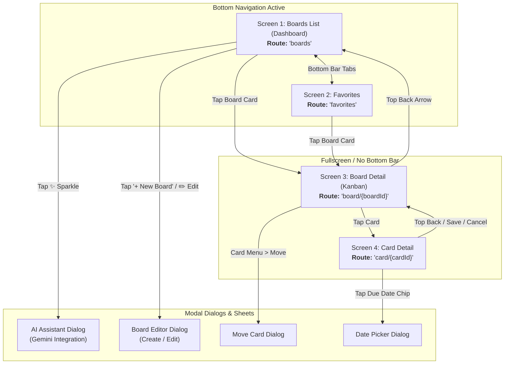

# 📋 Trello App: Complete Screen Flow & Architecture Guide

Welcome back! This document is your comprehensive walkthrough of the entire application. It explains every screen, what components and buttons are on each screen, what happens when you tap or drag items, where each navigation action leads, and how the underlying architecture ties everything together.

---

## 🧭 Navigation & Screen Hierarchy

The app uses **Jetpack Compose Navigation** (`NavHost`) configured in [`TrelloNavGraph.kt`](file:///e:/Trello_App/app/src/main/java/com/example/trello/presentation/navigation/TrelloNavGraph.kt). Routes are defined in [`NavDestinations.kt`](file:///e:/Trello_App/app/src/main/java/com/example/trello/presentation/navigation/NavDestinations.kt).



> [!NOTE]
> The **Bottom Navigation Bar** is only shown on the two top-level dashboard screens (**Boards** and **Favorites**). When you enter a board or a card detail screen, the bottom bar is automatically hidden so the Kanban board has full screen height.

---

## 📱 Detailed Screen-by-Screen Guide

---

### Screen 1: Boards Dashboard (`BoardsListScreen`)
* **File:** [`BoardsListScreen.kt`](file:///e:/Trello_App/app/src/main/java/com/example/trello/presentation/boards/BoardsListScreen.kt)
* **Route:** `NavDestination.BoardsList.route` (`"boards"`)
* **ViewModel & Contract:** [`BoardsListViewModel.kt`](file:///e:/Trello_App/app/src/main/java/com/example/trello/presentation/boards/BoardsListViewModel.kt) & [`BoardsListContract.kt`](file:///e:/Trello_App/app/src/main/java/com/example/trello/presentation/boards/BoardsListContract.kt)
* **Visual Reference:** `docs/images/my-boards.jpeg`

#### What It Contains:
1. **Top App Bar**:
   - Title: `"Your Boards"`
   - **✨ AI Assistant Action Icon** (`Icons.Default.AutoAwesome`): Opens the AI Bot dialog.
2. **Search Input Bar** (`OutlinedTextField`):
   - Real-time search with a 250ms debounce. Filters boards by title or description.
3. **Boards List (`LazyColumn`)**:
   - Displays all boards as elevated cards ([`BoardListItem.kt`](file:///e:/Trello_App/app/src/main/java/com/example/trello/presentation/common/components/BoardListItem.kt)).
   - Each card displays:
     - Board title & optional description.
     - Heart favorite icon (solid colored if favorited, outline if not).
     - Edit pencil icon.
     - Delete red trash icon.
     - List count and card count (e.g. `3 lists · 8 cards`).
     - Completion percentage (e.g. `62%`).
     - Colored horizontal progress bar reflecting the board's accent color.
4. **Floating Action Button (FAB)**:
   - Extended pill button: `"+ New board"` in brand blue (`#4772A6`).
5. **Bottom Navigation Bar**:
   - **Boards** tab (selected) and **Favorites** tab.

#### Interactive Behaviors:
| User Gesture / Tap | Resulting Action & Navigation |
| :--- | :--- |
| **Tap anywhere on a Board Card** | Navigates to **Screen 3: Board Detail** (`"board/{boardId}"`). |
| **Tap Heart Icon (❤️)** | Toggles favorite status in Room DB. Shows Snackbar: *"Board '<Title>' Added to Fav"*. |
| **Tap Edit Pencil Icon (✏️)** | Opens [`BoardEditorDialog`](file:///e:/Trello_App/app/src/main/java/com/example/trello/presentation/common/components/BoardEditorDialog.kt) to edit Title, Description, and Board Color. |
| **Tap Trash Icon (🗑️)** | Shows confirmation dialog. Upon confirming, deletes the board and displays an **Undo** Snackbar. Tapping "Undo" restores the board. |
| **Tap `+ New board` FAB** | Opens [`BoardEditorDialog`](file:///e:/Trello_App/app/src/main/java/com/example/trello/presentation/common/components/BoardEditorDialog.kt) with 9 color swatches to create a new board. |
| **Tap ✨ Sparkle Icon** | Opens [`AiAssistantDialog`](file:///e:/Trello_App/app/src/main/java/com/example/trello/presentation/ai/AiAssistantDialog.kt). |
| **Tap "Favorites" Bottom Tab** | Switches to **Screen 2: Favorites Screen**. |

---

### Screen 2: Favorites Screen (`FavoritesScreen`)
* **File:** [`FavoritesScreen.kt`](file:///e:/Trello_App/app/src/main/java/com/example/trello/presentation/favorites/FavoritesScreen.kt)
* **Route:** `NavDestination.Favorites.route` (`"favorites"`)
* **ViewModel & Contract:** [`FavoritesViewModel.kt`](file:///e:/Trello_App/app/src/main/java/com/example/trello/presentation/favorites/FavoritesViewModel.kt) & [`FavoritesContract.kt`](file:///e:/Trello_App/app/src/main/java/com/example/trello/presentation/favorites/FavoritesContract.kt)

#### What It Contains:
1. **Top App Bar**: Title `"Favorites"`.
2. **List of Favorited Boards (`LazyColumn`)**:
   - Shows only boards where `isFavorite == true`.
3. **Empty State**:
   - If no boards are favorited, displays a large outline heart icon with: *"Tap the heart btn on any board to pin it here."*
4. **Bottom Navigation Bar**:
   - Switch back to **Boards** tab.

#### Interactive Behaviors:
| User Gesture / Tap | Resulting Action & Navigation |
| :--- | :--- |
| **Tap Board Card** | Navigates directly to **Screen 3: Board Detail** (`"board/{boardId}"`). |
| **Tap Heart Icon or Delete** | Unpins the board from favorites immediately. Shows an **Undo** Snackbar to restore it. |

---

### Screen 3: Kanban Board Screen (`BoardScreen`)
* **File:** [`BoardScreen.kt`](file:///e:/Trello_App/app/src/main/java/com/example/trello/presentation/board/BoardScreen.kt)
* **Route:** `NavDestination.BoardDetail.route` (`"board/{boardId}"`)
* **ViewModel & Contract:** [`BoardViewModel.kt`](file:///e:/Trello_App/app/src/main/java/com/example/trello/presentation/board/BoardViewModel.kt) & [`BoardContract.kt`](file:///e:/Trello_App/app/src/main/java/com/example/trello/presentation/board/BoardContract.kt)
* **Visual Reference:** `docs/images/board-view.jpeg`

#### What It Contains:
1. **Themed Dynamic Background**:
   - The entire screen background takes the board's chosen color (e.g. Trello Blue `#0079BF`, Green `#519839`, etc.).
2. **Top App Bar**:
   - Navigation Back Button (`ArrowBack`): Navigates back to the Boards Dashboard.
   - Title: The board title (white text against the board color).
3. **Search & Filter Controls**:
   - **Search cards input**: Real-time filter of cards inside lists by keyword.
   - **Priority Filter Chips Row** ([`PriorityFilterRow.kt`](file:///e:/Trello_App/app/src/main/java/com/example/trello/presentation/board/components/PriorityFilterRow.kt)): Filter chips for `All`, `High`, `Medium`, and `Low`.
4. **Horizontal Columns (`LazyRow`)**:
   - Horizontally scrollable row containing [`ListColumn.kt`](file:///e:/Trello_App/app/src/main/java/com/example/trello/presentation/board/components/ListColumn.kt) items (width 272dp each).
   - An [`AddListButton.kt`](file:///e:/Trello_App/app/src/main/java/com/example/trello/presentation/board/components/AddListButton.kt) (`"+ Add list"`) card placed at the very end.

#### Inside Each Column ([`ListColumn.kt`](file:///e:/Trello_App/app/src/main/java/com/example/trello/presentation/board/components/ListColumn.kt)):
* **Header Row**:
  - Color dot.
  - List Title (clickable to rename).
  - Progress badge showing completed vs total cards (e.g., `2/4`).
  - Delete List button (red trash icon).
* **Cards Column (`LazyColumn`)**:
  - Contains all [`CardItem.kt`](file:///e:/Trello_App/app/src/main/java/com/example/trello/presentation/board/components/CardItem.kt) cards in this list.
* **Footer Button**:
  - `"+ Add card"` text button.

#### Inside Each Card ([`CardItem.kt`](file:///e:/Trello_App/app/src/main/java/com/example/trello/presentation/board/components/CardItem.kt)):
* **Cover Color Header**: If the card has a cover color, a colored strip appears at the top.
* **Labels**: Horizontal colored pill bars (Red, Purple, Blue, Green, Orange).
* **Completion Checkmark**: Check circle button. Tapping marks the card complete and strikes through the title.
* **Title**: Name of the card.
* **Metadata Chips**:
  - Priority chip (e.g., `HIGH` in red, `MED` in orange, `LOW` in green).
  - Due date chip with calendar icon (turns red if past due date).
  - Checklist badge (e.g. `2/5` with checklist icon; turns green when 100% complete).
* **Card Menu (`MoreHoriz`)**:
  - `Move to list`: Opens [`MoveCardDialog`](file:///e:/Trello_App/app/src/main/java/com/example/trello/presentation/board/components/MoveCardDialog.kt) to transfer card to another column.
  - `Delete`: Deletes the card.

#### Gestures & Advanced Interactions:
| Gesture / Action | What Happens |
| :--- | :--- |
| **Tap Card** | Navigates to **Screen 4: Card Detail** (`"card/{cardId}"`). |
| **Long-Press & Drag a Card** | Card lifts with scale 1.05x, alpha 0.9, and elevation. Drag up/down to reorder within the list, or across to drop into another list. |
| **Drag near screen edges** | The board **automatically scrolls horizontally** left or right so you can reach distant lists! |
| **Long-Press & Drag a List Header** | Lifts the entire list column and lets you **reorder lists horizontally**. |
| **Swipe Card Right-to-Left** | Uses Material 3 `SwipeToDismissBox` with red background and trash icon to delete the card. An Undo snackbar appears. |
| **Tap List Title** | Opens [`InputDialog`](file:///e:/Trello_App/app/src/main/java/com/example/trello/presentation/common/components/Dialogs.kt) to rename the list. |
| **Tap Trash on List** | Prompts with [`ConfirmDialog`](file:///e:/Trello_App/app/src/main/java/com/example/trello/presentation/common/components/Dialogs.kt) before deleting the list and all its cards. |
| **Tap `+ Add card`** | Opens an `InputDialog` prompt to enter card title. |
| **Tap `+ Add list`** | Opens an `InputDialog` prompt to create a new list column. |

---

### Screen 4: Card Detail Screen (`CardDetailScreen`)
* **File:** [`CardDetailScreen.kt`](file:///e:/Trello_App/app/src/main/java/com/example/trello/presentation/carddetail/CardDetailScreen.kt)
* **Route:** `NavDestination.CardDetail.route` (`"card/{cardId}"`)
* **ViewModel & Contract:** [`CardDetailViewModel.kt`](file:///e:/Trello_App/app/src/main/java/com/example/trello/presentation/carddetail/CardDetailViewModel.kt) & [`CardDetailContract.kt`](file:///e:/Trello_App/app/src/main/java/com/example/trello/presentation/carddetail/CardDetailContract.kt)
* **Visual Reference:** `docs/images/card-details.jpeg`

#### What It Contains:
1. **Top App Bar**:
   - Navigation Back Button (`ArrowBack`): Discards changes and returns to Board.
   - Title: `"Card detail"`.
   - Delete Button (`Icons.Default.Delete`): Deletes card with confirmation dialog.
2. **Editable Form (Vertical Scroll)**:
   - **Completion Toggle**: Checkbox row reading *"Mark as complete?"* or *"Completed"*.
   - **Title Field**: `OutlinedTextField` for card title (Required to save).
   - **Description Field**: Multi-line `OutlinedTextField` (4–8 lines) for detailed notes.
   - **Priority Selector** ([`PriorityComponents.kt`](file:///e:/Trello_App/app/src/main/java/com/example/trello/presentation/common/components/PriorityComponents.kt)): Select `None`, `Low`, `Medium`, or `High`.
   - **Labels Selector** ([`LabelSelector.kt`](file:///e:/Trello_App/app/src/main/java/com/example/trello/presentation/common/components/LabelSelector.kt)): 5 color swatches with checkmarks for toggling multiple labels.
   - **Cover Selector** ([`CoverColorSelector.kt`](file:///e:/Trello_App/app/src/main/java/com/example/trello/presentation/common/components/CoverColorSelector.kt)): Clear button or choose from 5 cover header colors.
   - **Due Date Chip** ([`DueDateComponents.kt`](file:///e:/Trello_App/app/src/main/java/com/example/trello/presentation/common/components/DueDateComponents.kt)): Displays formatted date (e.g. `Oct 28, 2026`). Tapping opens `DueDatePickerDialog`. An "X" button clears the date.
   - **Checklist / Subtasks Section** ([`ChecklistComponents.kt`](file:///e:/Trello_App/app/src/main/java/com/example/trello/presentation/common/components/ChecklistComponents.kt)): Real-time progress bar showing completion percentage, checkboxes with strikethrough, delete action, and quick inline add.
3. **Bottom Action Buttons**:
   - `"Cancel"`: Discards edits and pops back to the board.
   - `"Save changes"`: Writes all edits to Room DB and returns to the board.

---

### Screen Overlay: AI Assistant (`AiAssistantDialog`)
* **File:** [`AiAssistantDialog.kt`](file:///e:/Trello_App/app/src/main/java/com/example/trello/presentation/ai/AiAssistantDialog.kt)
* **ViewModel & UseCase:** [`AiAssistantViewModel.kt`](file:///e:/Trello_App/app/src/main/java/com/example/trello/presentation/ai/AiAssistantViewModel.kt) & [`InteractWithAiUseCase.kt`](file:///e:/Trello_App/app/src/main/java/com/example/trello/domain/usecase/InteractWithAiUseCase.kt)
* **Documentation File:** [`AI_DOCUMENTATION.md`](file:///e:/Trello_App/AI_DOCUMENTATION.md)

#### What It Does:
* Opens as a floating dialog from the ✨ sparkle button on the Boards screen.
* Connected to Google's Gemini AI (`gemini-flash-latest`).
* You can ask questions, ask for project planning advice, or tell it to create entire boards:
  > *"Create a mobile app release board with Backlog, In Development, QA, and Done lists."*
* The UseCase injects your current board titles as context, instructs the AI to return structured JSON for actions, parses the output, and executes `createBoard()` and `createList()` in Room DB. The new board appears on your dashboard instantly!

---

## 🏗️ Architecture & Data Mechanics

### 1. MVI (Model-View-Intent) Pattern
Every feature screen has three main elements:
* **Contract** (e.g. [`BoardContract.kt`](file:///e:/Trello_App/app/src/main/java/com/example/trello/presentation/board/BoardContract.kt)):
  - `State`: Data class holding the immutable UI state.
  - `Intent`: Sealed interface for every possible user interaction (`OnCardClicked`, `OnMoveCard`, etc.).
  - `Effect`: One-off events (navigation, showing snackbars).
* **ViewModel**: Collects intents, updates `StateFlow<State>`, and sends `Channel<Effect>`.
* **Screen Composable**: Purely renders `state` and dispatches `onIntent(...)`.

### 2. Database Schema (Room SQLite)
All data is stored locally in [`TrelloDatabase.kt`](file:///e:/Trello_App/app/src/main/java/com/example/trello/data/local/TrelloDatabase.kt) with cascading deletes:

```text
BoardEntity (id, title, description, colorHex, isFavorite, createdAt)
    │
    └── (1-to-many cascade) ──> CardListEntity (id, boardId, title, position)
                                    │
                                    └── (1-to-many cascade) ──> CardEntity (id, listId, title, description,
                                                                           position, priority, dueDate,
                                                                           isCompleted, labels, coverColor)
```

### 3. Fractional Drag-and-Drop Positioning
Items use `position: Double` instead of integer indices:
$$\text{newPosition} = \frac{\text{previousPosition} + \text{nextPosition}}{2.0}$$
* **Benefit:** When a card or list is moved, only that single entity's `position` is updated in the database. Other rows are untouched, keeping drag-and-drop 60fps smooth without batch SQL updates.

### 4. Non-Destructive Undo Deletions
When you delete a board, list, or card:
* The entity is cached in memory in the ViewModel (`recentlyDeletedBoard`, etc.).
* If the user taps **"Undo"** on the Snackbar, the repository calls `restore...()` which re-inserts the entity with a fresh primary key.

---

## 🗂️ File Quick Reference

| Responsibility | Key Files |
| :--- | :--- |
| **Navigation** | [`TrelloNavGraph.kt`](file:///e:/Trello_App/app/src/main/java/com/example/trello/presentation/navigation/TrelloNavGraph.kt), [`NavDestinations.kt`](file:///e:/Trello_App/app/src/main/java/com/example/trello/presentation/navigation/NavDestinations.kt) |
| **Boards List** | [`BoardsListScreen.kt`](file:///e:/Trello_App/app/src/main/java/com/example/trello/presentation/boards/BoardsListScreen.kt), [`BoardsListViewModel.kt`](file:///e:/Trello_App/app/src/main/java/com/example/trello/presentation/boards/BoardsListViewModel.kt), [`BoardsListContract.kt`](file:///e:/Trello_App/app/src/main/java/com/example/trello/presentation/boards/BoardsListContract.kt) |
| **Favorites** | [`FavoritesScreen.kt`](file:///e:/Trello_App/app/src/main/java/com/example/trello/presentation/favorites/FavoritesScreen.kt), [`FavoritesViewModel.kt`](file:///e:/Trello_App/app/src/main/java/com/example/trello/presentation/favorites/FavoritesViewModel.kt), [`FavoritesContract.kt`](file:///e:/Trello_App/app/src/main/java/com/example/trello/presentation/favorites/FavoritesContract.kt) |
| **Kanban Board** | [`BoardScreen.kt`](file:///e:/Trello_App/app/src/main/java/com/example/trello/presentation/board/BoardScreen.kt), [`BoardViewModel.kt`](file:///e:/Trello_App/app/src/main/java/com/example/trello/presentation/board/BoardViewModel.kt), [`BoardContract.kt`](file:///e:/Trello_App/app/src/main/java/com/example/trello/presentation/board/BoardContract.kt) |
| **Board Components** | [`ListColumn.kt`](file:///e:/Trello_App/app/src/main/java/com/example/trello/presentation/board/components/ListColumn.kt), [`CardItem.kt`](file:///e:/Trello_App/app/src/main/java/com/example/trello/presentation/board/components/CardItem.kt), [`MoveCardDialog.kt`](file:///e:/Trello_App/app/src/main/java/com/example/trello/presentation/board/components/MoveCardDialog.kt), [`DragDropState.kt`](file:///e:/Trello_App/app/src/main/java/com/example/trello/presentation/board/components/draganddrop/DragDropState.kt) |
| **Card Detail** | [`CardDetailScreen.kt`](file:///e:/Trello_App/app/src/main/java/com/example/trello/presentation/carddetail/CardDetailScreen.kt), [`CardDetailViewModel.kt`](file:///e:/Trello_App/app/src/main/java/com/example/trello/presentation/carddetail/CardDetailViewModel.kt), [`CardDetailContract.kt`](file:///e:/Trello_App/app/src/main/java/com/example/trello/presentation/carddetail/CardDetailContract.kt) |
| **Common UI & Dialogs** | [`BoardEditorDialog.kt`](file:///e:/Trello_App/app/src/main/java/com/example/trello/presentation/common/components/BoardEditorDialog.kt), [`Dialogs.kt`](file:///e:/Trello_App/app/src/main/java/com/example/trello/presentation/common/components/Dialogs.kt), [`DueDateComponents.kt`](file:///e:/Trello_App/app/src/main/java/com/example/trello/presentation/common/components/DueDateComponents.kt), [`LabelSelector.kt`](file:///e:/Trello_App/app/src/main/java/com/example/trello/presentation/common/components/LabelSelector.kt) |
| **AI Integration** | [`AiAssistantDialog.kt`](file:///e:/Trello_App/app/src/main/java/com/example/trello/presentation/ai/AiAssistantDialog.kt), [`AiAssistantViewModel.kt`](file:///e:/Trello_App/app/src/main/java/com/example/trello/presentation/ai/AiAssistantViewModel.kt), [`InteractWithAiUseCase.kt`](file:///e:/Trello_App/app/src/main/java/com/example/trello/domain/usecase/InteractWithAiUseCase.kt) |
| **Repository & Room** | [`TrelloRepositoryImpl.kt`](file:///e:/Trello_App/app/src/main/java/com/example/trello/data/repository/TrelloRepositoryImpl.kt), [`TrelloDatabase.kt`](file:///e:/Trello_App/app/src/main/java/com/example/trello/data/local/TrelloDatabase.kt) |
